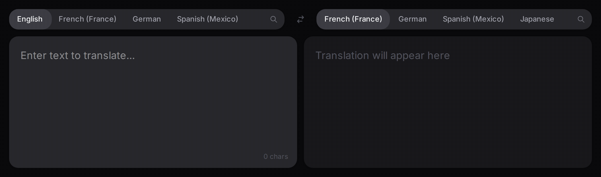

# TranslateGemma UI

[](https://github.com/realies/translategemma-ui/actions)
[](https://hub.docker.com/r/realies/translategemma-ui)
[](https://hub.docker.com/r/realies/translategemma-ui)

Web interface for [TranslateGemma](https://blog.google/innovation-and-ai/technology/developers-tools/translategemma/), Google's open translation model.



## Features

- **55 languages** — searchable language selector with recent language pills
- **Auto-translate** — starts translating as you type, no button needed
- **Auto-detect** — pick "Auto-detect" as the source and the server detects the language, no LLM round trip
- **Local inference** — no data leaves your machine, powered by [Ollama](https://ollama.ai)
- **Remembers preferences** — last used language pair and recents restored on reload
- **Swap languages** — flip source and target with one click
- **Translation stats** — shows duration and token count after each translation
- **Rate limiting** — built-in per-IP rate limiter for API requests
- **Localized UI** — interface labels adapt to your browser's language
- **Light & dark mode** — follows your system preference
- **Multi-arch Docker** — native images for `linux/amd64` and `linux/arm64`

## Quick Start

```yaml
services:
  translategemma-ui:
    image: realies/translategemma-ui
    container_name: translategemma-ui
    restart: unless-stopped
    ports:
      - 3000:3000
    environment:
      - OLLAMA_URL=http://host.docker.internal:11434
    extra_hosts:
      - "host.docker.internal:host-gateway"
```

Access the UI at `http://localhost:3000`

## Requirements

[Ollama](https://ollama.ai) running with a TranslateGemma model:

```bash
ollama pull translategemma:27b   # best quality (~16GB)
ollama pull translategemma:12b   # balanced (~7GB)
ollama pull translategemma:4b    # fastest (~2.5GB)
```

## Configuration

| Variable                       | Default                  | Description                                                                                          |
| ------------------------------ | ------------------------ | ---------------------------------------------------------------------------------------------------- |
| `OLLAMA_URL`                   | `http://localhost:11434` | Ollama API endpoint                                                                                  |
| `DEFAULT_MODEL`                | `translategemma:27b`     | Model to use (`27b`, `12b`, or `4b`)                                                                 |
| `PORT`                         | `3000`                   | Server port                                                                                          |
| `HOST`                         | `0.0.0.0`                | Server host                                                                                          |
| `LANGUAGE_DETECTOR`            | `lite`                   | Auto-detect engine: `lite` (CLD3) or `accurate` (GlotLID v4)                                         |
| `LANGUAGE_DETECTOR_PRELOAD`    | `false`                  | `true` loads the engine when the server starts, `false` on the first auto-detect request             |
| `LANGUAGE_DETECTOR_KEEP_ALIVE` | `5m`                     | Idle time before the engine unloads (`30s`, `5m`, `1h`, or seconds); negative = never, `0` = at once |

The server refuses to start when one of these `LANGUAGE_DETECTOR*` values is invalid.

## Source-Language Auto-Detection

The engine runs in the back end, only for requests whose source is "Auto-detect". The detected language is used for the prompt and shown on the pill ("Auto-detect: German"). When the text has no letters, or the engine names no supported language, the request fails with "Couldn't detect the language. Choose the source language." There is no silent default.

| Engine               | Short text (≤ 40 chars) | Longer text | Memory when loaded | Image size |
| -------------------- | ----------------------- | ----------- | ------------------ | ---------- |
| `lite` (CLD3)        | ~81%                    | ~97%        | ~+30 MB            | < 1 MB     |
| `accurate` (GlotLID) | ~93%                    | ~98%        | ~+500 MB           | +105 MB    |

Accuracy was measured on our own benchmark (Tatoeba and Wikipedia text in the 51 supported languages), so treat it as relative, not absolute. Memory is the server's RSS increase while the engine is loaded. Both engines ship in the Docker image, so switching is a matter of setting `LANGUAGE_DETECTOR`. Outside Docker, run `npm run fetch:glotlid` once before using `accurate`.

The engine's lifecycle works like Ollama's model loading. It loads on the first auto-detect request, or at startup with `LANGUAGE_DETECTOR_PRELOAD=true`; a preload failure stops the server from starting. It unloads after `LANGUAGE_DETECTOR_KEEP_ALIVE` of idle time, never while a detection is running. The engine runs in a worker thread, and unloading ends that thread, so its memory is returned to the system.

## Supported Languages

Arabic, Bengali, Bulgarian, Catalan, Chinese (Simplified/Traditional), Croatian, Czech, Danish, Dutch, English, Estonian, Filipino, Finnish, French (Canada/France), German, Greek, Gujarati, Hebrew, Hindi, Hungarian, Icelandic, Indonesian, Italian, Japanese, Kannada, Korean, Latvian, Lithuanian, Malayalam, Marathi, Norwegian, Persian, Polish, Portuguese (Brazil/Portugal), Punjabi, Romanian, Russian, Serbian, Slovak, Slovenian, Spanish (Mexico), Swahili, Swedish, Tamil, Telugu, Thai, Turkish, Ukrainian, Urdu, Vietnamese, Zulu

## Tech Stack

- [TanStack Start](https://tanstack.com/start) — React 19 full-stack framework
- [Tailwind CSS](https://tailwindcss.com) — styling
- [TypeScript](https://www.typescriptlang.org) — type safety
